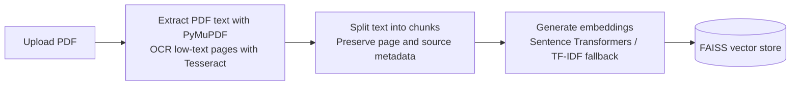
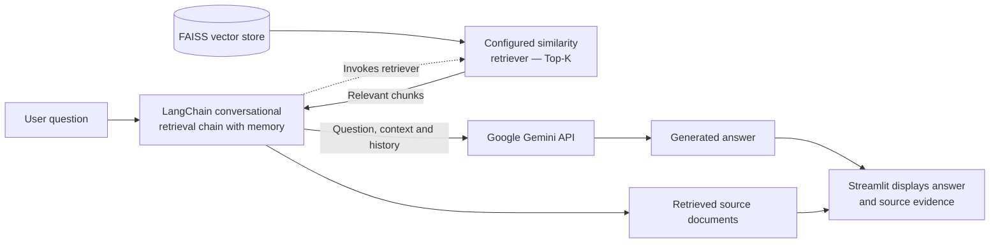

# 📚 CiteLens — Ask Questions About Your PDFs

CiteLens is a Retrieval-Augmented Generation (RAG) application that lets you ask questions about PDF documents and inspect the retrieved source passages behind the answers. It supports text-based PDFs and scanned pages through OCR, with source evidence and visual page highlights when metadata is available.

## Features

- Upload one or more PDF files through a Streamlit interface.
- Extract PDF text using PyMuPDF and use Tesseract OCR for pages with little or no extractable text.
- Split documents into text chunks and preserve page and source metadata.
- Generate embeddings using Sentence Transformers, with a TF-IDF fallback.
- Retrieve relevant chunks using a FAISS vector index.
- Generate contextual answers using Google's Gemini API through LangChain.
- Display retrieved source passages and, when available, highlight their regions on rendered PDF pages.
- Maintain conversational context during a session.
- Run locally with Python or in a Docker container.
- Deploy the Dockerized application as a web service on Render.

## Architecture

### 1. Document ingestion



### 2. Question answering



## Tech stack

| Component | Technology |
|---|---|
| Language | Python 3.11 |
| User interface | Streamlit |
| RAG orchestration | LangChain |
| Language model | Google Gemini API |
| Embeddings | Sentence Transformers with scikit-learn TF-IDF fallback |
| Vector retrieval | FAISS CPU |
| PDF processing | PyMuPDF, PyPDF2 and Pillow |
| OCR | Tesseract OCR |
| Containerization | Docker |
| Hosting | Render Web Service |

## Run locally on Windows

### 1. Prerequisites

Install:

- Python 3.11 or newer
- Git
- Tesseract OCR, with its executable available on your system `PATH`
- A Google Gemini API key from [Google AI Studio](https://aistudio.google.com/app/apikey)

### 2. Clone the repository and create a virtual environment

Open PowerShell in the directory where you want the project to live:

```powershell
git clone https://github.com/GovindTelang/CiteLens-assistant.git
cd CiteLens-assistant

py -3.11 -m venv .venv
.\.venv\Scripts\Activate.ps1

python -m pip install --upgrade pip
pip install -r requirements.txt
```

Create your local environment file:

```powershell
Copy-Item .env.example .env
code .env
```

Add your own configuration to `.env`:

```env
GEMINI_API_KEY=YOUR_GEMINI_API_KEY
MODEL_NAME=gemini-3.5-flash-lite
TOP_K=6
```

Replace the API-key placeholder with your own key. Do not commit `.env` or share your key.

If PowerShell blocks virtual-environment activation, you can use the environment's Python executable directly:

```powershell
.\.venv\Scripts\python.exe -m pip install -r requirements.txt
.\.venv\Scripts\python.exe -m streamlit run app.py
```

### 3. Start the application

With the virtual environment activated, run:

```powershell
python -m streamlit run app.py
```

If Streamlit's file watcher produces environment-specific errors while inspecting installed packages, try:

```powershell
python -m streamlit run app.py --server.fileWatcherType none
```

Open the local URL printed in the terminal, usually [http://localhost:8501](http://localhost:8501).

### 4. Use the application

1. Upload one or more PDFs using the sidebar.
2. Click **Process Documents** and wait for processing to finish.
3. Ask a question in the chat input.
4. Review the generated answer and expand the source-evidence panels to inspect the retrieved passages.

The first run may take longer because the embedding model needs to be downloaded and initialized.

## Run with Docker

Docker provides a consistent environment for the Python dependencies and system tools, including Tesseract OCR.

### 1. Build the image

Run from the repository root:

```powershell
docker build -t citelens-rag-assistant .
```

### 2. Run the container

After creating your local `.env` file, run:

```powershell
docker run --rm -p 7860:7860 --env-file .env citelens-rag-assistant
```

Open [http://localhost:7860](http://localhost:7860).

The `.env` file is passed into the running container. It is not copied into the Docker image by the Dockerfile. Avoid placing real API keys in source files, Docker build arguments, screenshots or Git history.

## Configuration

Configuration is read from the local `.env` file or environment variables, as supported by the application.

| Variable | Purpose |
|---|---|
| `GEMINI_API_KEY` | Required API key for Gemini |
| `MODEL_NAME` | Gemini model used for answer generation; the deployment example uses `gemini-3.5-flash-lite` |
| `EMBEDDING_MODEL` | Sentence Transformer model; the configured default is `sentence-transformers/all-MiniLM-L6-v2` |
| `CHUNK_SIZE` | Text chunk size in characters; configured default is `1000` |
| `CHUNK_OVERLAP` | Overlap between adjacent chunks; configured default is `200` |
| `TOP_K` | Number of retrieved chunks; configured default is `4` |
| `LLM_TEMPERATURE` | Generation temperature; configured default is `0.7` |
| `MAX_TOKENS` | Maximum output-token configuration; configured default is `2048` |

Environment variables set on the deployment host take precedence over local configuration files where the application reads them directly.

## Repository layout

| Path | Responsibility |
|---|---|
| `app.py` | Streamlit interface, upload flow, chat history and source-evidence display |
| `src/processor.py` | PDF text extraction, OCR fallback, page rendering and chunk metadata |
| `src/embedding.py` | Embedding generation, FAISS index and retrieval |
| `src/chat.py` | Gemini integration, RAG chain and conversational memory |
| `src/config.py` | Environment-based application configuration |
| `requirements.txt` | Python dependencies |
| `Dockerfile` | Container setup, system dependencies and Streamlit runtime |
| `.dockerignore` | Files excluded from the Docker build context |
| `.gitignore` | Excludes environment files, virtual environments and local data |
| `.env.example` | Safe example configuration without a real API key |
| `packages.txt` | System-package list for compatible Streamlit-hosted deployments; not used by the Render Docker build |

## Privacy and limitations

- Uploaded documents, embeddings and conversation state are held in application memory for the active session. This starter does not provide a persistent document library.
- Questions and retrieved document context are sent to the configured Google Gemini API to generate answers. Do not upload confidential or sensitive documents unless you have permission and have reviewed the applicable data-handling terms.
- Retrieved passages help inspect the basis of a response, but they do not guarantee that the generated answer is complete or correct. Verify important information against the original PDF.
- OCR accuracy depends on scan quality, text clarity and language support.
- The application does not include built-in authentication or per-user rate limiting. Visitors to a publicly accessible deployment may consume the configured Gemini API quota.
- This is a learning-focused project, not a production-ready secure document-management service. Broader deployment would require appropriate authentication, access isolation, upload limits, monitoring, error handling and security hardening.
