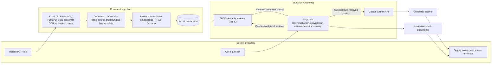

# 📚 CiteLens — Ask Questions About Your PDFs

CiteLens is a learning-focused Retrieval-Augmented Generation (RAG) application that lets you ask questions about PDF documents and inspect retrieved source passages. It supports text-based PDFs and scanned pages through OCR, and displays visual page citations when source metadata is available.

## Features

- Upload one or more PDF files through a Streamlit interface.
- Extract PDF text with PyMuPDF and use Tesseract OCR for pages that have little or no extractable text.
- Split document text into chunks and create embeddings with Sentence Transformers, with a TF-IDF fallback.
- Retrieve relevant chunks using a FAISS vector index.
- Generate contextual answers using Google's Gemini API through LangChain.
- Display retrieved source snippets and, when available, highlight their regions on rendered PDF pages.
- Support conversational memory during a session.
- Run locally with Python or in a Docker-based host such as Hugging Face Spaces.


## Architecture



## Tech stack

- **Language:** Python 3.10+
- **UI:** Streamlit
- **RAG orchestration:** LangChain
- **Language model:** Google Gemini API
- **Embeddings:** Sentence Transformers, with scikit-learn TF-IDF fallback
- **Vector retrieval:** FAISS CPU
- **PDF processing:** PyMuPDF, Pillow, Tesseract OCR
- **Deployment:** Streamlit Community Cloud, or Docker-based hosting

## Run locally on Windows

### 1. Prerequisites

Install Python 3.10 or newer and Git. For OCR on scanned PDFs, install Tesseract OCR and ensure its executable is available on your `PATH`. You also need a Google Gemini API key from [Google AI Studio](https://aistudio.google.com/app/apikey).

### 2. Get the code and create an environment

After creating your own GitHub repository, run these commands in PowerShell from the folder where you want the project to live:

```powershell
git clone https://github.com/GovindTelang/CiteLens-assistant.git
cd CiteLens-assistant
py -m venv .venv
.\.venv\Scripts\Activate.ps1
python -m pip install --upgrade pip
pip install -r requirements.txt
Copy-Item .env.example .env
code .env
```

After creating the repository under your account, this clone URL will work. In `.env`, set `GEMINI_API_KEY` to your own API key. Do not commit `.env` or share your key.

If PowerShell blocks virtual-environment activation, you can skip activation and call `.\.venv\Scripts\python.exe -m pip install -r requirements.txt`, followed by `.\.venv\Scripts\python.exe -m streamlit run app.py`.

### 3. Start the application

```powershell
streamlit run app.py
```

Open the local URL printed in the terminal, usually `http://localhost:8501`.

## Run with Docker

Build the image from the project root:

```powershell
docker build -t citelens-rag-assistant .
```

Run it while passing your API key as an environment variable:

```powershell
docker run --rm -p 7860:7860 -e GEMINI_API_KEY=YOUR_GEMINI_API_KEY citelens-rag-assistant
```

Then open `http://localhost:7860`. Avoid putting real API keys in command history or screenshots; a local `.env` file or your deployment host's secrets manager is preferable for regular use.

## Deploy (recommended: Streamlit Community Cloud)

For a first deployment, Streamlit Community Cloud is the simplest option because it deploys directly from GitHub and supports installing system packages through `packages.txt`.

1. Push this repository to your GitHub account.
2. Open [Streamlit Community Cloud](https://share.streamlit.io/) and sign in with GitHub.
3. Select **Create app**, then choose your repository, the `main` branch, and `app.py` as the entrypoint.
4. In **Advanced settings**, choose Python 3.11 for the deployment environment.
5. Add the following in the app's **Secrets** settings, replacing the placeholder with your own key:

   ```toml
   GEMINI_API_KEY = "your-gemini-api-key"
   ```

6. Deploy the app and review the logs if dependency installation or startup fails.

The `src/config.py` configuration reads `GEMINI_API_KEY` from the local `.env` file/environment or from Streamlit's secrets store, so you do not need to commit a real key. The `packages.txt` file installs Tesseract for OCR on scanned PDFs. **Before sharing a public demo:** anyone who can access the app may trigger Gemini requests against your configured API key and quota. This starter has no authentication or per-user rate limit, so keep the app private during setup or add access controls before sharing it widely. Streamlit's official deployment docs describe the GitHub deployment flow and `packages.txt` support: [deploying an app](https://docs.streamlit.io/deploy/streamlit-community-cloud/deploy-your-app/deploy) and [app dependencies](https://docs.streamlit.io/deploy/streamlit-community-cloud/deploy-your-app/app-dependencies).

## Alternative: run with Docker

The included Dockerfile installs Tesseract and serves Streamlit on port `7860`.

```powershell
docker build -t citelens-rag-assistant .
docker run --rm -p 7860:7860 -e GEMINI_API_KEY=YOUR_GEMINI_API_KEY citelens-rag-assistant
```

Then open `http://localhost:7860`. For a hosted Docker deployment, check the provider's current pricing, free-tier eligibility, and environment-secret instructions before creating the service. Never place API keys in source files, Docker build arguments, README content, or Git history.

## Configuration

Values can be configured in `.env`:

| Variable | Default | Purpose |
|---|---|---|
| `GEMINI_API_KEY` | Required | Google Gemini API access |
| `MODEL_NAME` | `gemini-3.8-flash` | Model used for answer generation |
| `EMBEDDING_MODEL` | `sentence-transformers/all-MiniLM-L6-v2` | Text embedding model |
| `CHUNK_SIZE` | `1000` | Chunk size in characters |
| `CHUNK_OVERLAP` | `200` | Overlap between adjacent chunks |
| `TOP_K` | `4` | Number of chunks retrieved for a question |
| `LLM_TEMPERATURE` | `0.7` | Generation temperature configuration |
| `MAX_TOKENS` | `2048` | Maximum output-token configuration |

## Repository layout

| Path | Responsibility |
|---|---|
| `app.py` | Streamlit UI, upload flow, chat history and source display |
| `src/processor.py` | PDF extraction, OCR fallback, page rendering and chunk metadata |
| `src/embedding.py` | Embedding generation, FAISS index and retrieval |
| `src/chat.py` | Gemini integration, RAG chain and conversational memory |
| `src/config.py` | Environment-based application configuration |
| `requirements.txt` | Python dependencies |
| `Dockerfile` | Docker image and Streamlit runtime |
| `.env.example` | Safe configuration template without a real API key |
| `packages.txt` | System packages for Streamlit Community Cloud (Tesseract OCR) |

## Privacy and limitations

- Uploaded files and indexes are held in application memory for the active session; this starter does not provide a persistent document library.
- Questions and retrieved document context are sent to the configured Google Gemini API to generate answers. Do not upload confidential or sensitive material unless you have permission and have reviewed the applicable data-handling terms.
- Retrieval and generated answers can be incomplete or incorrect. Check the displayed source passages before relying on an answer.
- Scanned-PDF OCR quality depends on scan quality and language support.
- This project is a learning starter, not a production-ready secure document-management service. Authentication, isolation between users, upload limits, monitoring, and production security hardening would be needed for broader deployment.
